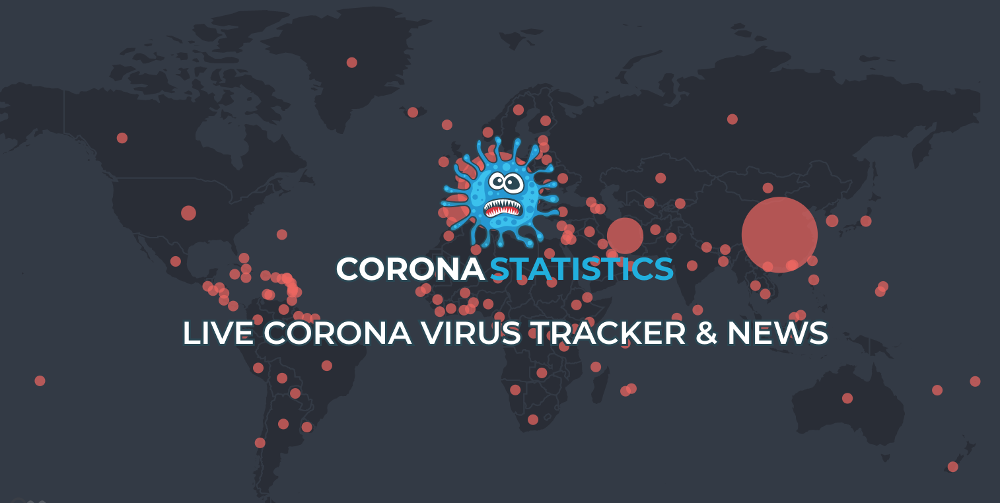
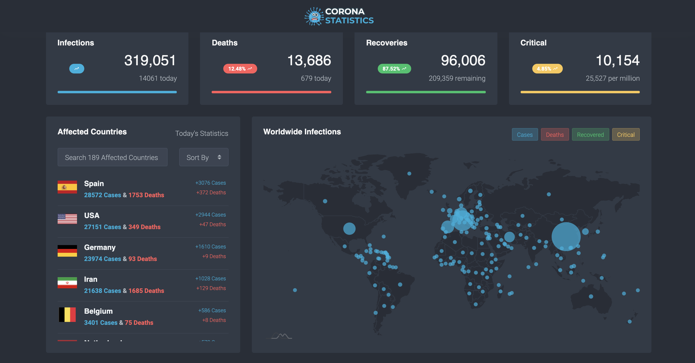
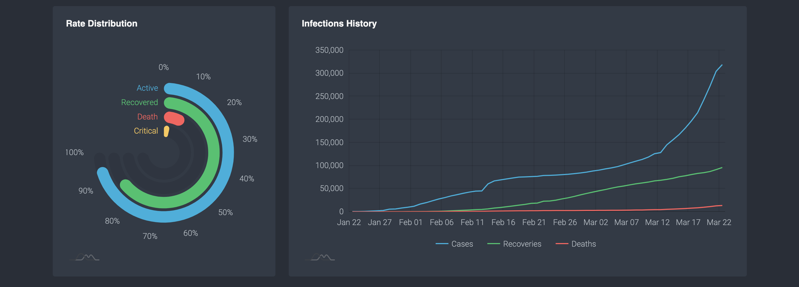
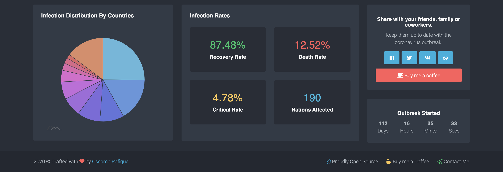
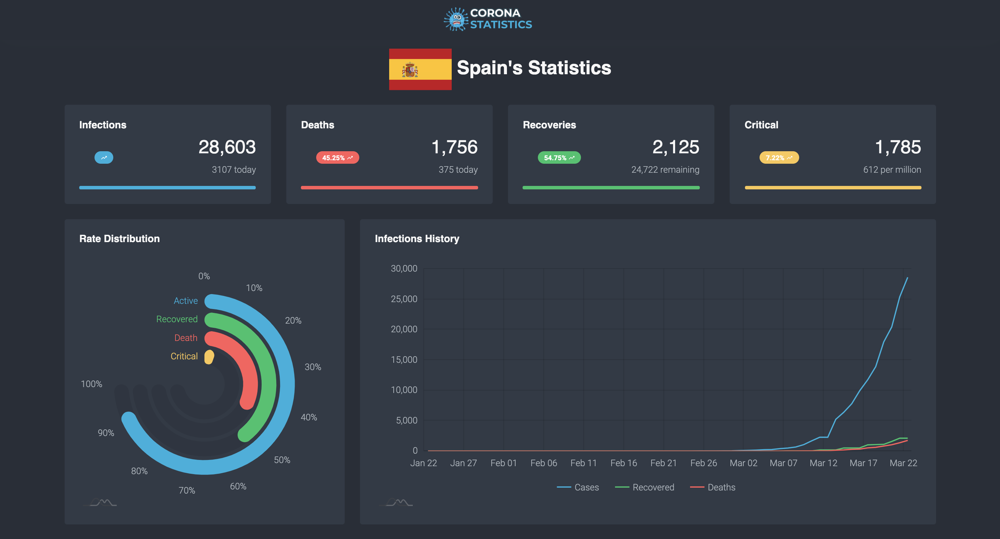

<h1 align="center">(Unmaintained Repo) Welcome to 🦠 COVID-19/Corona Statistics Dashboard Angular 👋</h1>
<p>
  
    
  <a href="#" target="_blank">
    
  </a>
<!--   <a href="https://discord.gg/QFmHc9" target="_blank">
    
  </a> -->
  <a href="https://ko-fi.com/ossamarafique" target="_blank">
    
  </a>
  <a href="https://twitter.com/OssamaRafique" target="_blank">
    
  </a>
</p>
> ## ⚠️ Demo purposes only — the data is not real
>
> This project is **no longer maintained**. It showed live COVID-19 figures while it was, but the API
> behind it (`api.coronastatistics.live`) and the hosted site have both been retired.
>
> So that the dashboard still demonstrates what it does, it now ships with **randomly generated
> sample data** — every number you see in the app is fabricated. These are **not real COVID-19
> statistics** and must not be cited, shared or used for anything. Search, sorting, the world map,
> the charts and the per-country pages all work, they are just driven by a seeded generator
> (`src/app/core/mock/demo-data.ts`) instead of a live API.
>
> Want real numbers? See [Using a real API](#using-a-real-api) below.



_The screenshot above and those below were taken while the project was live and showing real data._

### 🏠 [Homepage](https://github.com/OssamaRafique/Covid-19-Statistics-Dashboard-Angular-9)

### ✨ Demo — the hosted site has been retired, [run it locally](#run-the-angular-project) instead

### ✨ [Join Discord Server For Help](https://discord.gg/QFmHc9)

## Screenshots






## Build the Angular project

```sh
npm install
```

```sh
ng build
```


## Run the Angular Project

```sh
npm install
```

```sh
ng serve
```

It starts on the generated sample data, so there is nothing else to set up — no API key, no backend,
no network. Remember that every figure on screen is fake; the dashboard shows a banner saying so.

> **Note:** this is an Angular 9 project and its build toolchain needs **Node 12 or 14**. On a newer
> Node, `npm install` will fail while compiling `node-sass`.

## Using a real API

Dummy data is controlled by a single flag in `src/environments/environment.ts` (and
`environment.prod.ts`):

```ts
export const environment = {
  production: true,
  useDummyData: true,                            // set to false for live data
  apiHost: 'https://api.coronastatistics.live'   // and point this at your own deployment
};
```

Set `useDummyData` to `false` and `apiHost` to your own instance of the Node server in `server/`
(below). The app's HTTP calls are unchanged, and the demo banner disappears on its own.

## Run the Node.js Project (open server folder)

Rename config.example.json to config.json and fill in the details

```
{
  "redis": {
    "host": "host",
    "password": "1234"
  },
  "keys": {
    "all": "coronastatistics:all",
    "countries": "coronastatistics:countries",
    "timeline": "coronastatistics:timeline",
    "timelineglobal": "coronastatistics:timelineglobal"
  },
  "interval": 600000
}
```

```sh
npm install
```

```sh
node server.js
```

Then set `apiHost` in `src/environments/environment.ts` to wherever you deployed it, as described in
[Using a real API](#using-a-real-api).

# API Endpoints

**These endpoints are dead — `api.coronastatistics.live` no longer resolves.** They are kept here as
a description of the shape the app expects, which is what the sample data generator reproduces and
what you would need to serve to run this against real data:

* `/all`
* `/countries`
* `/countries?sort={parameter}`
* `/countries/{country_name}`
* `/timeline`
* `/timeline/global`
* `/timeline/{country_name}`

## Author

👤 **Ossama Rafique**

* Website: https://www.ossamarafique.com
* Twitter: [@OssamaRafique](https://twitter.com/OssamaRafique)
* Github: [@OssamaRafique](https://github.com/OssamaRafique)
* LinkedIn: [@OssamaRafique](https://linkedin.com/in/OssamaRafique)
* Buy me a Coffee: https://ko-fi.com/ossamarafique

## Show your support

Give a ⭐️ if this project helped you!

[](https://ko-fi.com/C0C71IRSG)
